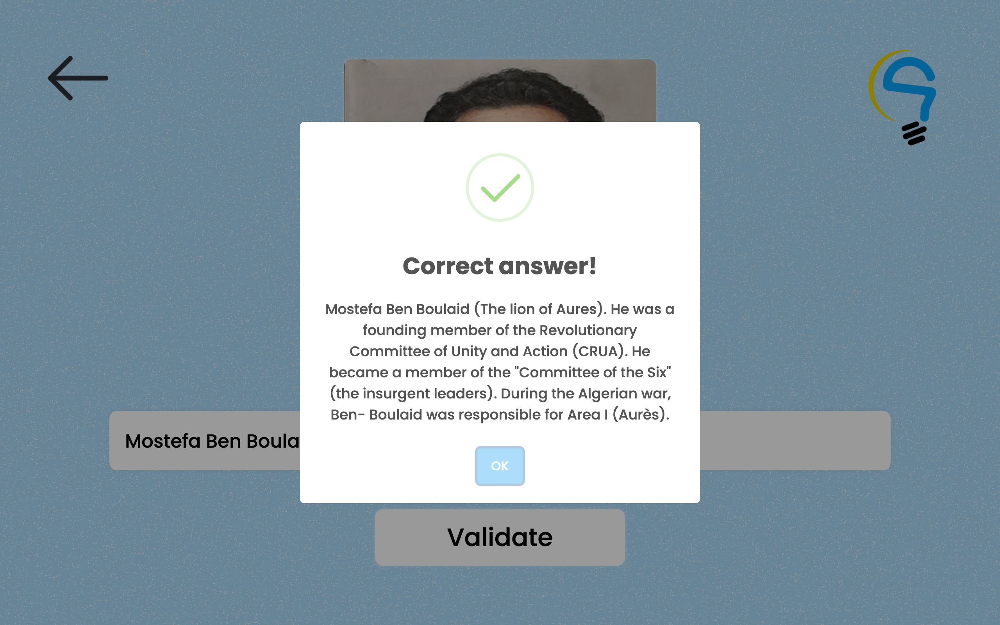
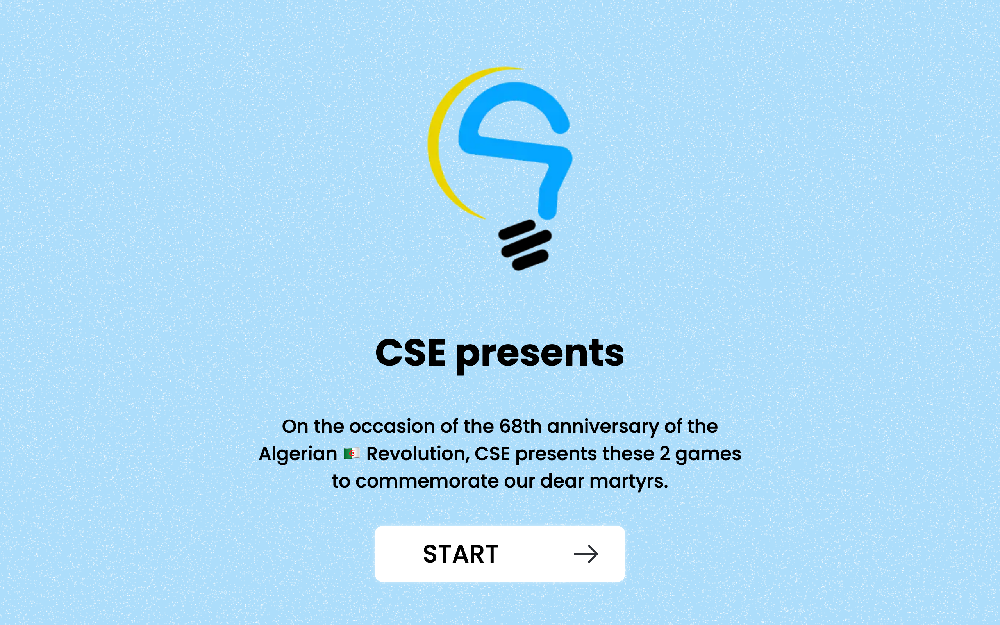
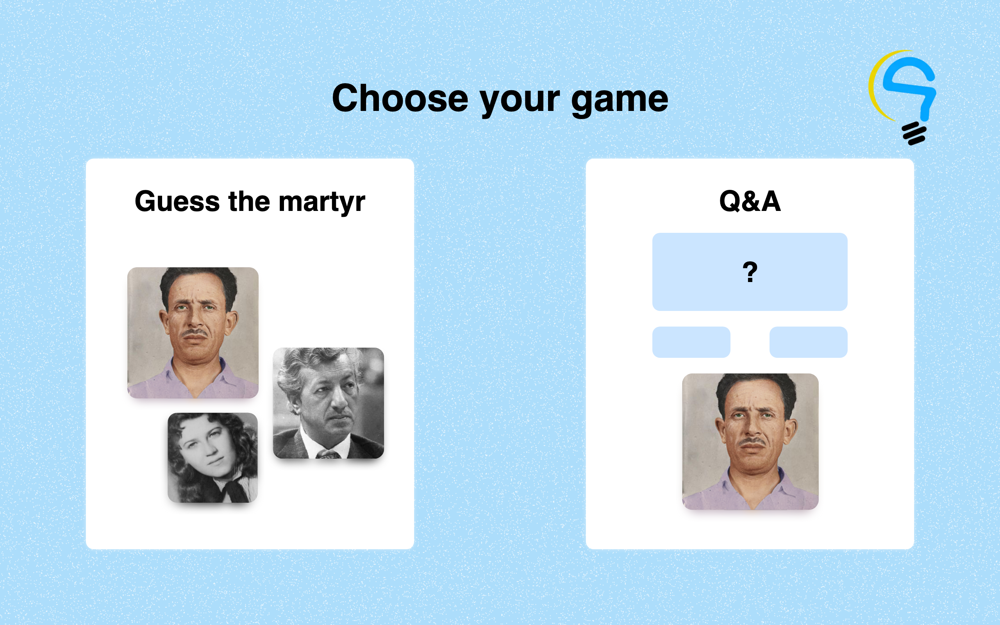
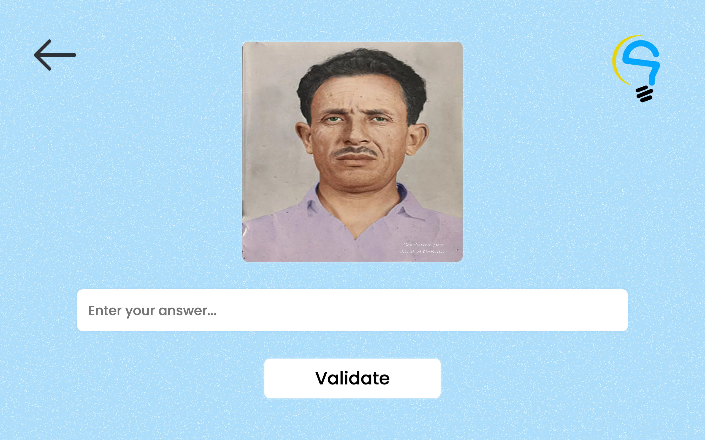
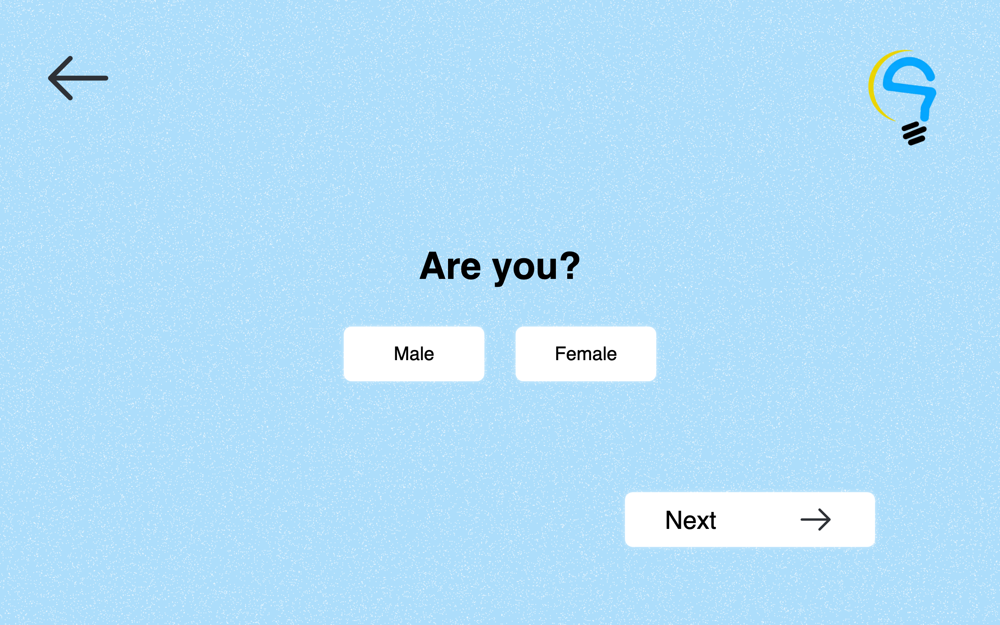

# Martyrs of the Revolution: two games for 1 November

Two small browser games made for the Scientific Club of ESI (CSE) for the 68th anniversary of the start of the Algerian Revolution, 1 November 2022. Players put names to the faces of seven leaders of the revolution, or take a short personality quiz that matches them with one of them. Each answer comes with a short biography.



| Start screen | Choose a game |
|---|---|
|  |  |

| Guess the face | Personality quiz |
|---|---|
|  |  |

## How it works

- **Face game:** names are compared with [string-similarity](https://www.npmjs.com/package/string-similarity) (Dice coefficient), and anything above 0.6 counts, so "Mostefa Ben Boulaid" is accepted for "Mostefa Benboulaid". Feedback and biographies appear in SweetAlert2 dialogs.
- **Quiz:** eleven yes/no and scale questions build an answer profile, which is compared with a stored profile for each figure.
- Built solo with Next.js 13 and React 18 in October 2022, with Swiper for the game picker.

## Running it

```bash
npm install
npm run dev     # http://localhost:3000
```

## Notes

- Portraits are loaded from Wikimedia Commons; some are colourised versions credited on the image to Jalal Al-Kara.
- Known limitations: the quiz only shows a result when the answers match a stored profile exactly, the layout is designed for desktop screens, and the main actions are styled `div`s rather than buttons, so they are not reachable from the keyboard.
- November 2026: fixed HTML entities (`&quot;`) that appeared literally in two biographies, and added these screenshots.
